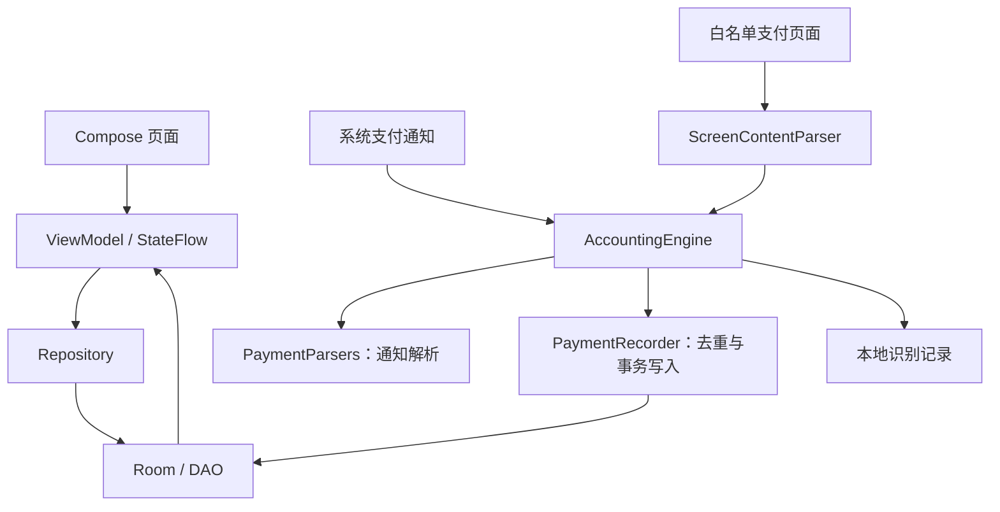

# 自动记账 App 项目概览

更新日期：2026-10-22。本文描述当前工作区的 **V1.2.3**，用于新对话快速接手；是否已对外发行，以 Gitee/GitHub 的发行版为准。

## 接手时先看什么

1. 本文：理解产品作用、功能、架构和边界。
2. [VERSION_HISTORY.md](VERSION_HISTORY.md)：从顶部了解最近各版本的主要改动。
3. [AGENTS.md](AGENTS.md)：确认命名、视觉与业务约定。
4. 涉及构建、测试、打包时，再读 [DEVELOPMENT.md](DEVELOPMENT.md)。

动手前检查 Git 状态和 app/build.gradle.kts 中的版本。工作区可能包含尚未提交的前几轮改动，不要通过重置工作区来消除这些内容。

## App 的主要作用

一款原生 Android 本地记账工具：通过支付应用通知自动识别部分收支，辅以可选的支付页面识别；同时支持手动记账、账户余额、报销管理、查账和统计。

最低系统 Android 8.0，当前 versionCode=16。账单和账户以本地 Room 数据库保存；诊断样本也保存在应用私有存储，并排除系统备份。

## 已有主要功能

### 首页与手动记账

- 首页展示当月收支、结余和按天分组的交易列表。
- 手动添加支出、收入、账户间转账，选择分类、账户、交易时间，填写商户和备注。支出/收入/转账切换固定在页顶，滚动表单时仍可见。
- 交易时间使用年、月、日、时、分五列滚动选择，打开时回显原时间；取消不修改，确认按本地时区保存到分钟，切换月份或年份时自动限制有效日期。
- 金额键盘支持加减计算；支出可以标记需要报销。
- 详情可以编辑、删除、调整账户与分类；支出可生成退款记录。
- 首页滑动删除后有约4秒撤销窗口。窗口从删除完成时按设备单调时钟计算，切换页面不会重新计时；过期不再恢复提示。撤销只消费一次并恢复原记录ID，防止重复还原余额。

### 查账与筛选

入口：首页右上角放大镜。

- 胶囊搜索框支持商户、备注、金额、账户名和分类名。
- 筛选支持分类多选、支付途径多选、全部/待报销/已报销。
- 同一项内部为多选匹配，不同项与关键词之间取交集。
- 支付途径以账单保存的账户类型为准，默认包括微信、支付宝、银行卡、京东和美团；不推测钱包背后的实际扣款银行卡。转账可以匹配转出或转入途径，同一条账单只显示一次。
- 展示符合条件的笔数、收入/支出或报销金额汇总；不会仅搜索最近30笔。
- 筛选面板的“重置”先确认，再清除分类、支付途径和报销状态并立即应用，保留搜索关键词，不需要再点应用。
- 空结果中的“重置查找”同时清空关键词与筛选，也有确认。

### 我的、账户与设置

- 顶部资产概览：净资产、总资产、负债、账户数量。
- 账户放在同一张卡片内分行展示，支持新建、编辑名称/银行、余额校准和受保护删除。
- 账户余额键盘支持十进制加减、等号、清空和负余额；余额校准不会额外生成收支账单。
- “设置”位于账户区域后的页面末尾，包含自动记账授权、服务连接状态、屏幕白名单、识别记录、后台耗电管理与CSV导出。
- 账户删除带有交易记录检查，避免直接删除仍在使用的账户。

### 报销

- 支出勾选需要报销后进入待报销，列表显示标签。
- 详情可以“标记已报销”或“改回待报销”，查账提供相应筛选和金额合计。
- 状态切换只更新标记，不改变账户余额，也不自动生成收入。实际报销到账另记收入。
- CSV导出包含报销状态。

### 统计

- 周、月、年、自定义日期范围，支持上一期/下一期和下拉刷新。
- 总览、支出、收入切换；分类占比、分类账单明细、每日趋势和年度月度支出。每日趋势显示金额纵轴（大金额使用万/亿单位），支持点击或横向拖动连续查看日期与金额；纵向手势仍用于页面滚动。
- 转账不计入收入和支出统计；按设备本地日期汇总。

## 自动记账工作方式

1. **主要通道：PaymentNotificationListener**。系统通知使用权授权后接收新的支付通知，不依赖无障碍常开。
2. **可选补充：FinanceNotificationService**。使用无障碍读取明确白名单应用的支付结果页；通知读取未连接时，可回退处理白名单应用的通知事件。
3. **解析：PaymentParsers / ScreenContentParser**。提取金额、方向、商户等信息；不确定、未完成交易和已知营销内容保持保守。
4. **统一处理：AccountingEngine → PaymentRecorder**。串行处理、通道间短时去重、匹配账户和分类，再写入账单。
5. **写入保障**。事件回执、自动账单和余额变动在同一数据库事务中提交；同一通知事件重投不重复入账。
6. **诊断**。最近100条支付识别样本可在设置中查看、复制、清空与测试；样本测试不会写入账本。

屏幕白名单：微信、支付宝、京东、美团、美团外卖、大众点评。系统配置和运行时代码使用一致名单，银行不在屏幕读取范围中。

## 技术框架

- 原生 Kotlin + Jetpack Compose + Material 3。
- Navigation Compose 管理页面与导航。
- MVVM：Compose界面 → ViewModel → Repository → Room DAO。
- 协程与 Flow/StateFlow 驱动异步任务、列表刷新和状态展示。
- Room 数据库，当前结构版本8，包含历史迁移；DataStore保存少量偏好，SharedPreferences保存有上限的诊断样本。
- AppModule 负责手工依赖组装，没有引入 Hilt/Dagger。
- Android NotificationListenerService 与 AccessibilityService 负责两条采集通道。



主要目录：

```text
app/src/main/java/com/financetracker/
  ui/             页面、组件、主题、导航、ViewModel
  domain/         交易模型、用例、金额计算、撤销时间窗口
  data/           Room表/DAO/迁移、仓库、偏好设置
  notification/   通知监听、无障碍补充、解析、入账与诊断
  di/AppModule    依赖组装
```

视觉方向：温暖轻松的奶油色系，鼠尾草绿与陶土色区分收支，优先保证金额、状态和操作入口清晰。

## 已知边界与尚未完成

- 无通知、金额被隐藏、工作资料隔离、普通银行短信和未覆盖模板，不能保证自动记全。
- 部分银行检测的是“无障碍是否开启”，白名单无法保证解除拦截；需要时关闭屏幕识别，通知通道仍可工作。
- 系统强制停止、撤销授权和不同品牌后台限制，仍需用户恢复与真机验证。
- 同一支付的平台与银行通知、商户不一致的两通道采集，仍可能重复；不会仅凭金额跨来源自动合并。
- 多个同类账户无法确定归属时保留待补记。京东/美团账户代表通知来源，未必是实际资金账户。
- 现有导出是CSV；完整备份恢复、账单导入、日期/具体账户筛选、跨来源交易关联、自定义规则编辑器仍未实现。
- 当前交付APK为调试签名。正式覆盖旧发布版须核对签名并先备份数据。

## 文档维护规则

每次完成功能变动：更新本文中变化的当前行为，并在 VERSION_HISTORY.md 顶部添加对应版本的主要概括。不要复制整段聊天或堆积过程日志；把已实现、已验证和待完成分清。构建细节放 DEVELOPMENT.md，本机验证摘要放 artifacts/latest/验证记录.md。
